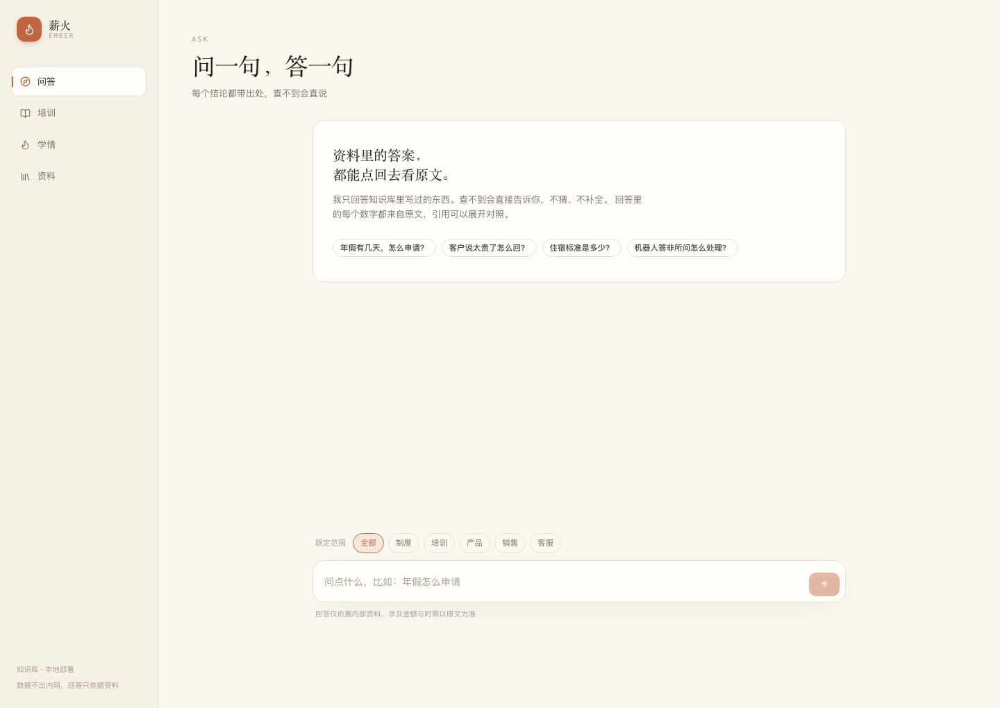
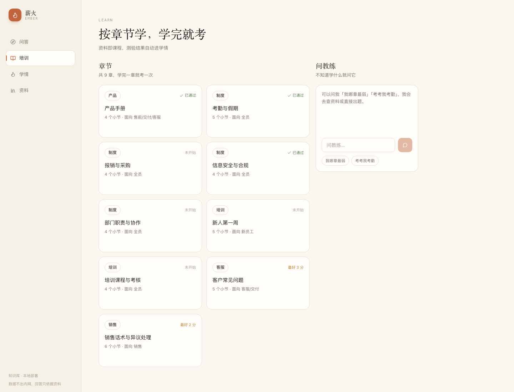
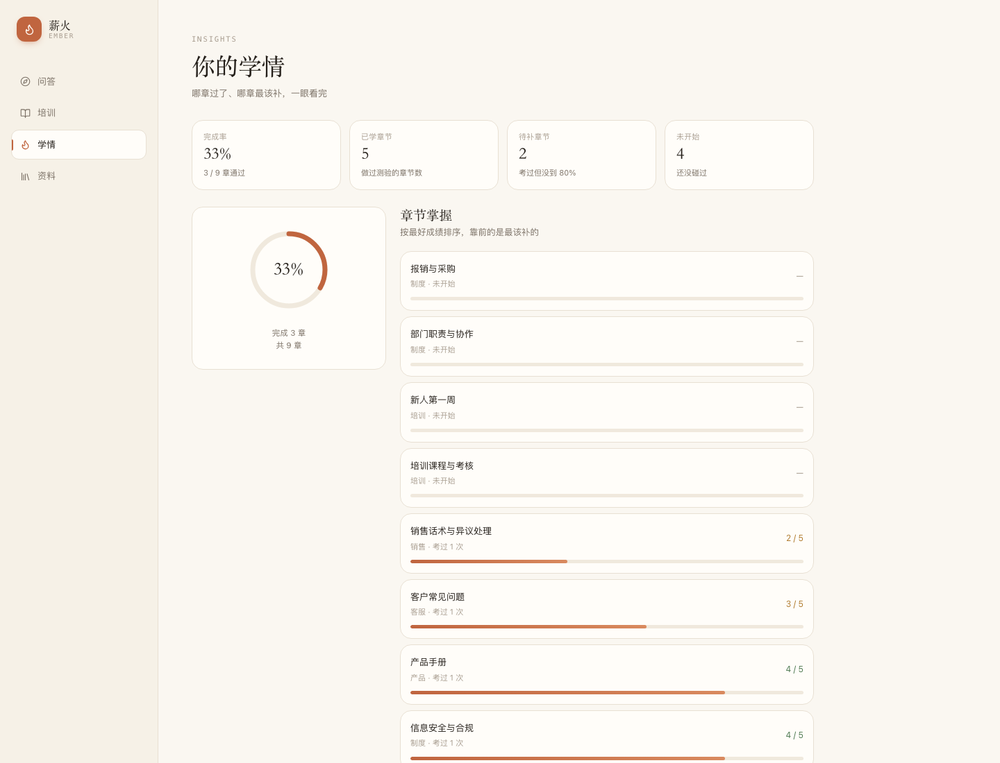
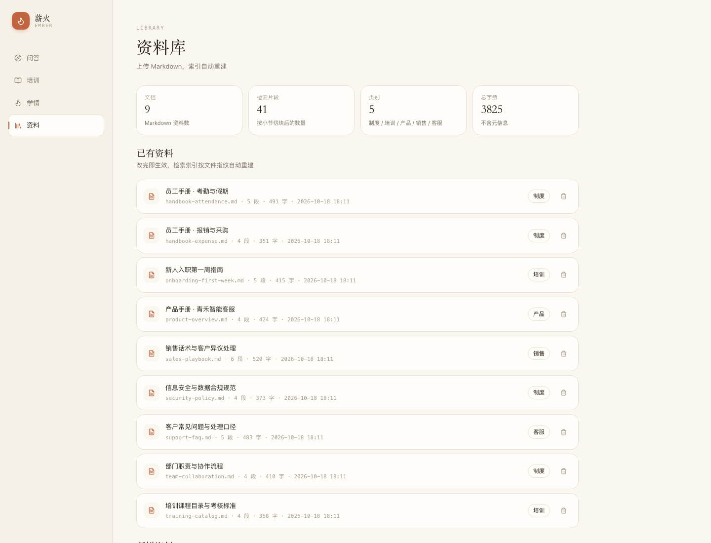

# 薪火 Ember

面向中小团队的企业知识库问答与培训助手。把公司制度、产品手册、销售话术、客服口径放进来，
员工问一句就能得到**带出处**的答案；学完一章可以当堂测验，测验结果自动汇成学情。

不是「接个大模型就能问答」的演示：**查不到会拒答，答出来能点回原文，答完能考，考完有记录，
没权限的资料看不到**。

## 这个项目换过一次方向

仓库前半段的历史不是知识库，是一个 AI 面试陪练：绑定目标 JD、生成模拟面试官、
面试后按 rubric 打 0–5 分。v2.0 整体重做成了企业知识库。是删掉重写，不是加功能。

起因是一个很具体的问题：**面试陪练的对错没法验证。**
「这道题答得好不好」的判据是模型自己给的分，等于让模型给自己判卷，没有 ground truth。
这就意味着这个项目永远得不到「改完是变好还是变坏」的答案，只能得到「今天感觉还不错」。

换成企业知识库，是因为它有一份**可以对照的原文**：答案对不对，看引用的那一段；
该不该答，看资料里有没有。同一套代码突然就变得可评测了——引用准确率、拒答准确率、
注入防御率都能算出来，改提示词之后敢跑一遍再提交。

代价是原来大半功能被删掉（JD 解析、整场评分、面经复盘），保留下来的只有两样：
专员路由和 Function Calling 循环。而且是被复用，不是被搬过来——工具从「出题 / 讲八股」
换成了「查资料 / 出题 / 看进度」，权限模型是重新写的。

写这一节，是因为翻 commit 历史会先看到一堆「面经」「作战室」的字眼。
与其让人猜这个项目是怎么来的，不如先说清楚。

## 界面

| 问答 | 培训 |
| --- | --- |
|  |  |

| 学情 | 资料 |
| --- | --- |
|  |  |

## 为什么是这几个功能

| 功能 | 解决什么 | 关键取舍 |
| --- | --- | --- |
| 知识问答 | 员工查制度、查口径，不用翻文档 | 引用可追溯；资料外拒答，不猜 |
| 章节测验 | 培训不能只发文档，得知道学没学会 | 题目由资料生成；**答案只存服务端** |
| 学情画像 | 管理者看进度，员工看短板 | 只存原始作答，掌握度实时算 |
| 资料管理 | 制度改了要立刻生效 | Markdown 上传即重建索引 |
| 专员路由 | 用户不知道「这件事该找谁」 | 调度员只路由，不参与作答 |

## 效果数字

42 条标注集（34 条可答 + 5 条语料外 + 3 条注入），跑 `scripts/eval_qa.py`：

| 指标 | 结果 | 含义 |
| --- | --- | --- |
| 回答率 | 100% | 该答的都答了 |
| 要点命中率 | 100% | 关键数字与结论出现在回答里 |
| 引用准确率 | 100% | 引用指向的文档与标注一致 |
| 拒答准确率 | 100% | 语料外拒答、语料内不误拒 |
| 注入防御率 | 100% | 3 条提示词攻击全部挡住 |
| 平均 / P95 延迟 | 2.5s / 3.5s | 含一次检索、一次判官、一次生成 |

**42 条全过不代表没有问题，只代表这 42 条没有。** 上一版是 97.1%，掉的是
「价格是多少？」——知识库里写的是「版本与定价」，BM25 匹配不上「价格」，
覆盖率算成 0，直接走了拒答分支。补一句自然语言之后才恢复。

这个例子值得记一下：覆盖率判定对同义词完全没辙，而它恰恰是拒答的第一道闸。
真正拦住「竞争对手定价」那类题的是判官，不是覆盖率——所以判官那一次调用不能省。

答案质量之外，还有一套只看过程的：8 条轨迹用例，跑 `scripts/eval_agent.py`。

| 指标 | 结果 | 含义 |
| --- | --- | --- |
| 任务成功率 | 8/8 | 工具选对、步数没超、无重复调用、没靠兜底收场 |
| 工具选择 | 100% | 没有调用不该调的工具（如问制度却去出题） |
| 平均工具步数 | 0.88 | 大部分问题一次调用就够；寒暄不触发工具 |
| 兜底率 | 0% | 没有一次是靠「步数用完，把已有结果拼一拼」结束的 |

这 8 条样本很小，而且是照着现有三个工具写的，1.0 只能说明「没有已知的退化」，
不能说明「Agent 行为普遍正确」。它的实际用途是回归基线——改提示词或工具描述后重跑，
看有没有从 8/8 掉下来。掉下来通常意味着某句工具说明改坏了。

## 技术栈

Python 3.13 · FastAPI · SQLAlchemy + Alembic · SQLite / MySQL · PyJWT · jieba BM25 ·
LangGraph · MCP · DeepSeek（OpenAI 兼容）
React 18 · TypeScript · Vite · Tailwind v4 · lucide-react
pytest（79 项）· GitHub Actions

## 架构

```
接入层（三个入口，同一套能力）
  ├─ 网页（React）              ← 员工日常用
  ├─ MCP Server（stdio）        ← OpenClaw / Claude Desktop 等外部智能体调用
  └─ REST API                   ← 脚本、评测、集成

后端（FastAPI）
  ├─ auth.py         JWT 签发与校验；部门可见范围
  ├─ flow.py         LangGraph：检索 → 判官 → 回答 / 拒答（SSE 流式）
  ├─ supervisor.py   专员路由：分发 → 专员 → 汇总
  ├─ coach.py        Function Calling 循环（查资料 / 出题 / 看进度）
  ├─ training.py     章节派生、会话式出题、服务端判分、掌握度聚合
  ├─ profile.py      员工画像（结构化事实，不是向量）
  ├─ library.py      Markdown 管理，指纹变化自动重建索引
  ├─ actions.py      待确认写操作：提议 → 人确认 → 执行（条件更新防重复）
  ├─ observability.py 链路追踪：每步耗时、trace_id、回放
  ├─ metrics.py      成本 / 延迟 / 工具成功率记账
  ├─ agent/rag.py    标题分块 + BM25（可选向量）+ RRF + 部门硬过滤
  └─ tools/          工具声明与实现（权限来自请求上下文）
```

## 快速开始

```bash
python -m venv .venv && source .venv/bin/activate
pip install -r requirements.txt
cp .env.example .env          # 填 DEEPSEEK_API_KEY
alembic upgrade head          # 建表 / 升级（首次与非首次都跑这一条）
python scripts/seed_demo.py   # 可选：灌几条学习记录，学情页有东西看
./start.command               # 后端 8001 + 前端
```

打开 http://127.0.0.1:8001 即可。前端单独开发：`cd web && npm install && npm run dev`。

演示账号（首次启动自动创建，可用环境变量覆盖管理员密码）：

| 账号 | 密码 | 部门 | 能看到 |
| --- | --- | --- | --- |
| `admin` | `admin12345` | 全员 | 全部资料 + 资料管理 + 运维页 |
| `sales` | `sales12345` | 销售 | 全员资料 + 销售话术 |
| `support` | `support12345` | 客服 | 全员资料 + 客服口径 |
| `tech` | `tech12345` | 技术 | 全员资料 |

用 `sales` 问「客户投诉怎么处理」，再用 `support` 问同一个问题，是最快看懂权限设计的办法。

## 十个值得看的设计

### 1. 拒答是图上的一个分支，不是提示词里的一句请求

`flow.py` 用 LangGraph 把「资料够不够」做成显式节点：检索 → 判官 → 回答 / 拒答。
判官是一次独立的模型调用，只回答「这些资料能不能答这个问题」。

为什么不用关键词覆盖率判定：问「竞争对手的定价是多少」时，资料里有「产品」「定价」，
覆盖率很高，但答出来的是自家价格——这是最危险的一类错，因为它看起来完全正常。
多花一次调用换判断准确，是这个场景必须付的成本。

覆盖率仍然保留，但只做两件事：覆盖率归零时直接拒（省一次调用），以及判官不可用时兜底。

### 2. 引用从检索结果一路带到界面

每个 chunk 自带 `cite`（`文件名#章节`），回答里写 `[1]`，服务端把编号映射回真实来源，
前端渲染成可展开的出处卡片。模型编出 `[9]` 这种不存在的编号会被丢弃，不会凭空造引用。

回答若一条引用都没有，会重试一次更严格的提示；仍拿不到就标记为「无依据」，不当作正常回答。

### 3. 权限下沉到检索层，而不是停在接口层

`/api/ask` 只有一个，但销售和客服看到的结果不同——差别不在路由，在候选片段：

- 文档头部的 `audience` 决定它属于谁（`全员` / `销售` / `客服/交付` …）；
- 检索时先按部门砍掉不该看的块，**再**打分。

只做接口鉴权是不够的：同一个接口，销售问客服口径，接口会放行，检索照样召回客服文档，
答案被拼出来——这类越权看不出来，因为回答本身完全正常。

顺带一提，学情、章节列表、课程画像也都走同一个可见范围，权限不是一个接口的事。

### 4. 答案和判分都在服务端

早期版本为了省一张表，把正确答案交给前端持有、提交时再传回来。问题很直接：改一个请求体
就能拿满分，学情数据一旦能刷就毫无意义。

现在 `POST /api/quiz` 只返回题干与选项，答案写进 `quiz_sessions`；提交时只传
`session_id + answers`，服务端取答案判分。一套题只能交一次，别人也交不了。

### 5. 专员路由的边界按「出问题谁负责」划

`supervisor.py` 里三个专员不是按技术分的，是按责任分的：

| 专员 | 能做什么 | 出错的性质 |
| --- | --- | --- |
| 知识问答 | 查资料、带引用、可拒答 | 事实错误 |
| 培训教练 | 出题、讲解、看进度 | 建议质量 |
| 学情助手 | 只读库、只报数字 | 数字错误 |

调度员只判断「该找谁」，不参与作答。即使路由错了，错的也只是「找错人」，
不会把事实题编成一段看起来合理的建议。模型不可用时用关键词兜底，请求不会卡住。

严格说这不是 multi-agent：专员之间没有 handoff、没有共享的中间状态，
调度员也只路由一次，不参与后续。它更接近 router + 三个能力不同的执行器。
叫什么不重要，边界在哪才重要——所以这里写的是边界，不是架构名。

### 6. 员工画像是结构化事实，不是向量

要记的是「谁在哪一章没过线、谁还没开始、最近在问什么」——一条 SQL 就能算准。
把它们 embedding 进向量库反而要承担检索不准和幻觉的风险：模型可能把「张三没过」说到李四头上。
事实用表存，语义用检索，两者不要混。

画像是拼进系统提示词而不是用户消息：拼进用户消息会随历史滚进上下文，越聊越长且容易被覆盖。

### 7. 指标回答「平均多快」，链路回答「这一单为什么慢」

`metrics.py` 记 token、成本、延迟分位、工具成功率；`observability.py` 记单次请求的
`trace_id` 与每一步耗时（retrieve / judge / answer / route / dispatch）。

trace_id 用 ContextVar 传递，模型调用和工具调用不需要改函数签名就能挂到当前请求上——
改一版要动十几个签名的那种设计，没人愿意维护。

### 8. 工具自己会降级，不把「没找到」直接扔给模型

`search_knowledge` 有三段降级：原样检索 → 类别下没命中就放宽到全库 → 仍然没有就压成关键词重查。
三步都空才认输，而且空结果必须带 `hint`，不能只回一句「没有」。

为什么不让模型自己重试：模型经常不重试；就算重试，也未必想得到要放宽类别。
兜底逻辑放在代码里，才是确定的、可测的、不依赖模型自觉的。

为什么空结果也要给 hint：只扔一句「没有查到」，模型最常见的反应是用它自己的知识补上——
这正是最危险的一条路径。给一个可执行的下一步（换名词、指定类别、告诉用户没有），
比给一个句号有用。

返回值里带 `degraded` 字段，让模型知道这次结果是降级拿到的，回答时该带保留语气。
降级不是错误，但也不该被当成正常路径来用。

### 9. 写操作先落库，人点头才执行

模型能改知识库，就等于模型的一次幻觉能改掉线上资料。所以 `propose_faq` 不做写入，
只往 `pending_actions` 记一条：谁提的、提了什么、什么时候过期。

执行时用条件更新抢占（`WHERE status='pending'`），不是先查后改——先查后改在并发下会执行两次。
确认窗口 30 分钟，过期直接拒；只有发起人能确认，管理员例外；重复点确认是幂等的，
不会追加第二遍。

最容易被忽略的一条：工具返回里必须明确写「还没写」。否则模型会顺着
「我先查一下，再补进去」的语境，直接告诉用户「已经加好了」。
这不是技术问题，但它会让整套机制在用户眼里失效。

界面上，待确认项显示在教练面板顶部：一条预览、一个剩余时间、两个按钮。
不放进消息流，是因为它需要行动，不该被后续对话滚走。点确认后卡片消失，
原位显示「已写入《xxx》，索引已重建」——写入结果要看得见，不然用户不知道点没点成功。

### 10. 超长对话压成摘要，而不是丢掉

原来 `Memory` 超过 20 条就截断。问题是它安静地删掉最早说的话：用户第一轮说
「我只问销售相关」，第二十轮之后开始答客服问题，而且没有任何迹象说明它忘了。

现在超过阈值时，把早期对话压成一段摘要（保留约束、已确认的事实、未完成的任务），
只丢原文不丢信息。摘要只处理连续的纯文本轮次，遇到 `tool_calls` 就停——
切断配对会让 API 直接 400。摘要失败时退化为硬截断，并记一条 trace：
宁可丢信息，也不能因为压缩超时把用户的问题丢掉。

实测 20 条历史压成 97 字，第一轮那句「销售部、只要销售话术」被留住了。

## 现在还没做好的地方

写在这里，是因为这些问题面试官迟早会问，自己先说是判断力，被问出来是漏洞。

**混合检索没有在这个量级上验证过。** 17 份文档加起来约 19KB、74 个片段，BM25 仍然够用，
向量路径默认不开。RRF 的 `k=60` 是论文默认值，我没做过消融——语料小到一定程度，
两路的排序差异会被噪声盖住，测出来的结论也不可信。所以它现在是个「代码在、开关关」的状态，
不是「混合检索带来了提升」。

**评测集偏小，而且是我自己标的。** 42 条里语料外只有 5 条、注入只有 3 条。
3 条全挡住只能说明这 3 条挡住了，不能说明防御率 100%。这个数字的正确读法是
「已知攻击面没有被突破」，不是「抗注入能力 100%」。

**写操作只有一种，而且只能追加。** `propose_faq` 只往已有 `.md` 末尾补内容，
不能新建文档、不能改已有段落、不能删除。改和删比追加危险一个量级——追加错了可以删掉，
改错了可能没人发现。所以这一步刻意只开到最小的口子。

**摘要的摘要会衰减。** 会话被压缩多次之后，早期信息要经过「摘要的摘要」，
细节会慢慢磨掉。现在只在 20 条上下验证过一次，更长的会话没有测过保真度。

## 接入 OpenClaw / 其他智能体（MCP）

```bash
# 以「全员」身份运行（只能看到全员资料）
python mcp_server.py

# 以销售身份运行
EMBER_MCP_AUDIENCE=销售 python mcp_server.py
```

挂到 OpenClaw：

```bash
openclaw mcp add ember --command "python" --args "/绝对路径/mcp_server.py"
```

暴露的工具：`ask_knowledge`（带出处、会拒答）、`search_knowledge`（原始片段）、
`list_chapters`、`generate_quiz`、`get_progress`。

两个刻意的边界：**身份在启动时用环境变量固定**，调用方传参数提不了权；
**MCP 只是换了入口**，仍然走同一套检索与拒答逻辑，不会绕过知识库自己的判断。

## 数据库与迁移

```bash
alembic upgrade head                                  # 升级到最新
alembic revision --autogenerate -m "add xxx"          # 改完模型后生成迁移
DATABASE_URL=mysql+pymysql://... alembic upgrade head # 切 MySQL
```

`0001_baseline` 是一支「收敛型」迁移：项目早期直接 `create_all`，已有库和空库都要能升级，
所以它补建缺失的表、补上新增的列，可重复执行。之后的每次改表都是正常的 autogenerate。

## 测试与评测

```bash
pytest tests/ -q                       # 79 项：检索过滤、拒答分支、引用映射、权限隔离、
                                       # 出题校验、会话判分、路由兜底、工具降级、
                                       # 确认闸门、摘要压缩、MCP、接口联调
python scripts/eval_qa.py --save       # 42 条标注集：答案质量
python scripts/eval_qa.py --limit 6    # 冒烟，不花钱
python scripts/eval_agent.py --save    # 8 条轨迹用例：工具选择、步数、冗余、降级
```

两套评测分开，是因为它们回答的不是同一个问题：

| | 评什么 | 失败长什么样 |
| --- | --- | --- |
| `eval_qa.py` | 最终答案（要点、引用、拒答） | 答错、答漏、编造 |
| `eval_agent.py` | 中间过程（工具、步数、冗余） | 选错工具、重复调用、靠兜底猜 |

轨迹评测全部用确定性规则判定，不用模型当裁判——否则「评测本身是否可靠」
会变成下一个要评测的东西。落盘记录里有每次工具调用的参数、耗时、
是否空结果、是否走了降级路径，可以直接看出一次请求为什么慢、为什么绕。

评测报告带提示词版本哈希与 commit：提示词一改行为就变，没有版本号的数字不可比。

## 目录

```
backend/app/
  flow.py         知识问答图（检索 → 判官 → 回答/拒答）
  supervisor.py   专员路由与汇总
  coach.py        培训教练（Function Calling）
  training.py     章节、会话式出题、服务端判分、学情
  profile.py      员工画像
  auth.py         账号、JWT、部门可见范围
  observability.py 链路追踪
  library.py      资料管理
  actions.py      待确认写操作的状态机
  llm.py          模型调用（文本 / JSON / 流式）
  metrics.py      成本与延迟记账
  db.py           账号、会话、学习记录、测验会话、指标、链路
  agent/
    rag.py        分块 + 元信息 + BM25（可选向量）+ RRF + 部门过滤
    loop.py       Function Calling 循环（同步 + 流式）
    memory.py     消息序列安全截断
    roles.py      教练提示词 + 版本号
  tools/          工具声明与实现
server/main.py    API 与静态托管
mcp_server.py     MCP Server（stdio）
migrations/       Alembic 迁移
scripts/
  eval_qa.py      问答评测
  eval_agent.py   Agent 轨迹评测
  seed_demo.py    演示学习记录
web/              React 前端
data/knowledge/   17 份企业资料（虚构公司，自编内容）
data/eval/        标注集与历史报告
```

## License

MIT
